# MyPortfolio – Kişisel Portfolyo Web Sitesi

ASP.NET Core MVC ile geliştirilen portfolyo projesidir. Proje; kişisel bilgileri, yetenekleri, deneyimleri ve projeleri dinamik olarak sergilemek ve yönetim paneli üzerinden içerikleri takip etmek amacıyla hazırlanmıştır.

## 🛠️ Kullanılan Teknolojiler

- C#
- ASP.NET Core MVC
- Entity Framework Core
- Microsoft SQL Server
- HTML, CSS, JavaScript
- Bootstrap
- Razor Views

## 🌐 Web Sitesi Sayfaları

### 🏠 Ana Sayfa
- **Kişisel Tanıtım:** İsim ve tanıtım yazısı.
- **Hakkımda:** Kişisel bilgiler ve eğitim bilgileri.
- **Yetenekler:** Teknik beceriler ve seviyeleri.
- **Deneyimler:** Mesleki deneyimlerin listelenmesi.
- **Projeler:** Projelerin ve görsellerinin sergilenmesi.
- **Referanslar:** Referans bilgilerinin görüntülenmesi.
- **İletişim:** Telefon, e-posta ve adres bilgilerinin gösterilmesi.
- **Sosyal Medya:** GitHub, LinkedIn ve diğer sosyal medya bağlantıları.
- **İletişim Formu:** Ziyaretçilerin mesaj gönderebilmesi.

## 🔐 Yönetim Paneli Sayfaları

### 📋 Yapılacaklar Listesi
- Görevleri listeleme.
- Yeni görev ekleme.
- Mevcut görevleri güncelleme ve silme.
- Görevleri tamamlandı veya bekliyor olarak işaretleme.

### 💼 Deneyim Yönetimi
- Deneyimleri listeleme.
- Yeni deneyim ekleme.
- Deneyim bilgilerini güncelleme ve silme.
- Başlık, unvan, tarih ve açıklama bilgilerini yönetme.

### 📞 İletişim Bilgileri
- Telefon numaralarını görüntüleme.
- E-posta adreslerini görüntüleme.
- Adres bilgilerini görüntüleme.

### 📩 Gelen Kutusu
- Ziyaretçilerden gelen mesajları listeleme.
- Mesaj detaylarını görüntüleme.
- Mesajları okundu veya okunmadı olarak işaretleme.
- Mesajları silme.

### 📊 İstatistikler
- Toplam yetenek sayısını görüntüleme.
- Toplam mesaj sayısını görüntüleme.
- Okunan ve okunmayan mesaj sayılarını görüntüleme.
- Yetenek seviyelerini çubuk grafikle gösterme.
- Yapılacakların tamamlanma durumunu halka grafikle gösterme.

## 🗄️ Veritabanı
Microsoft SQL Server ve Entity Framework Core kullanılarak veriler yönetilmektedir. Görevler, deneyimler, yetenekler, projeler, iletişim bilgileri ve ziyaretçilerden gelen mesajlar veritabanında tutulmaktadır.

## 📸 Proje Görselleri

### 🏠 Ana Sayfa
<table>
  <tr>
    <td>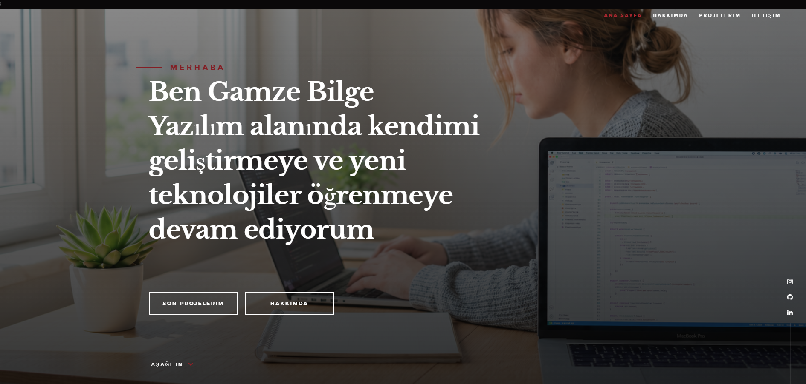</td>
    <td>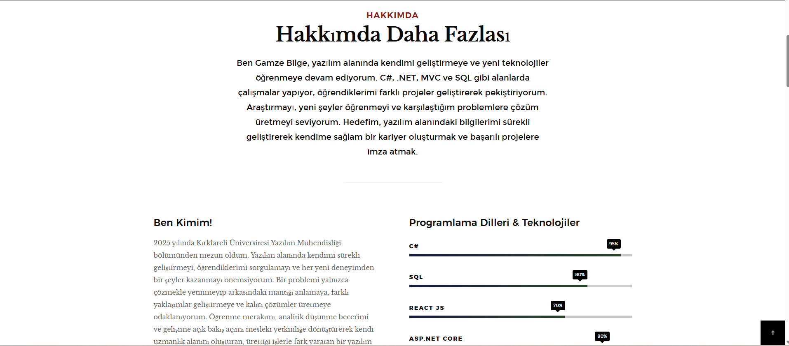</td>
  </tr>
  <tr>
    <td>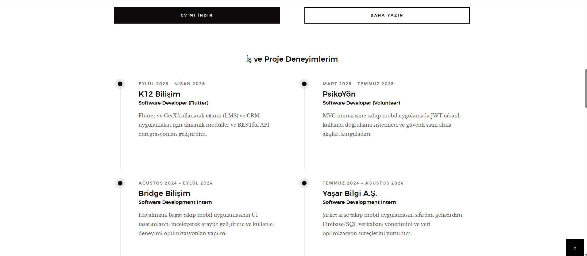</td>
    <td>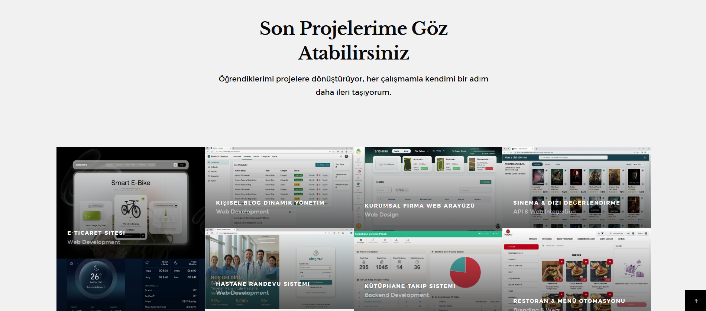</td>
  </tr>
  <tr>
    <td>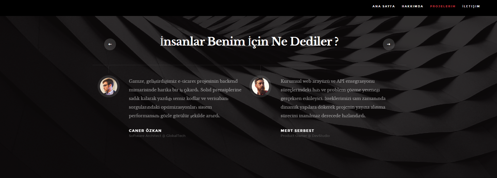</td>
    <td>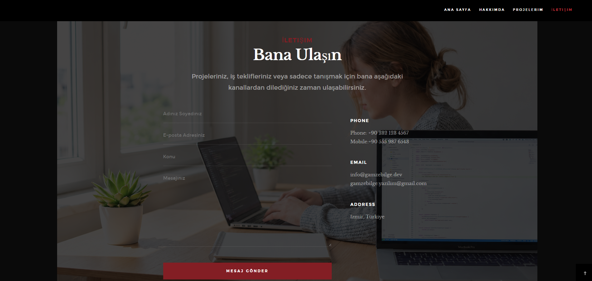</td>
  </tr>
</table>


### 📋 Yapılacaklar Listesi
<p align="center">
  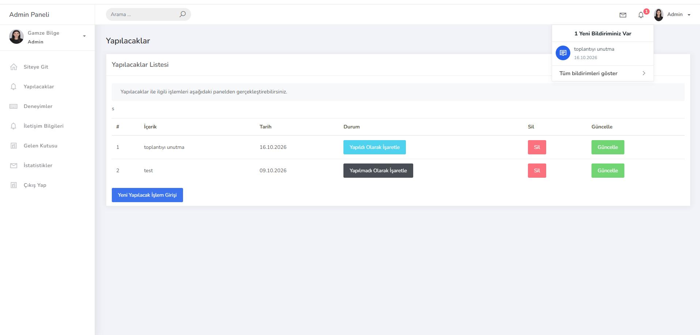
</p>

### 💼 Deneyimler
<p align="center">
  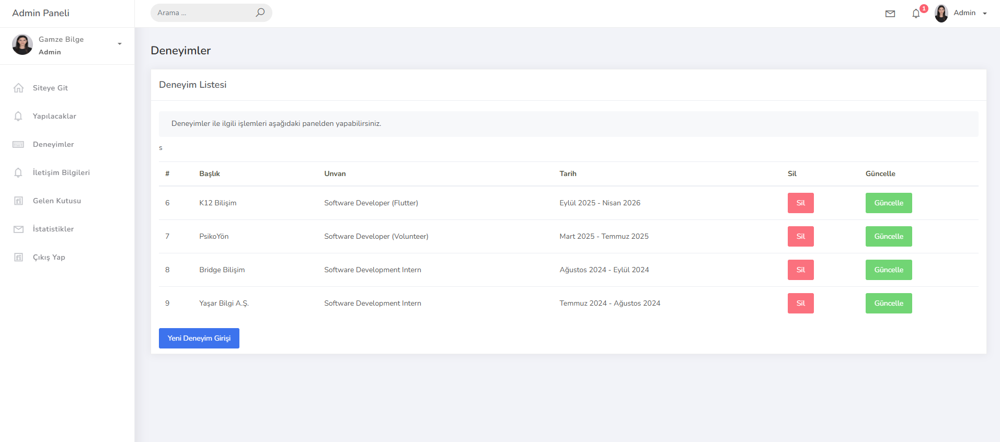
</p>

### 📞 İletişim Bilgileri
<p align="center">
  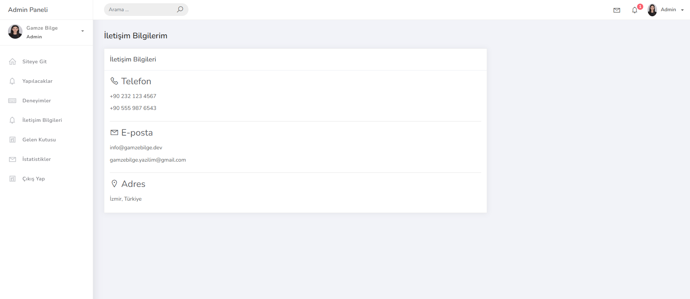
</p>

### 📩 Gelen Kutusu
<p align="center">
  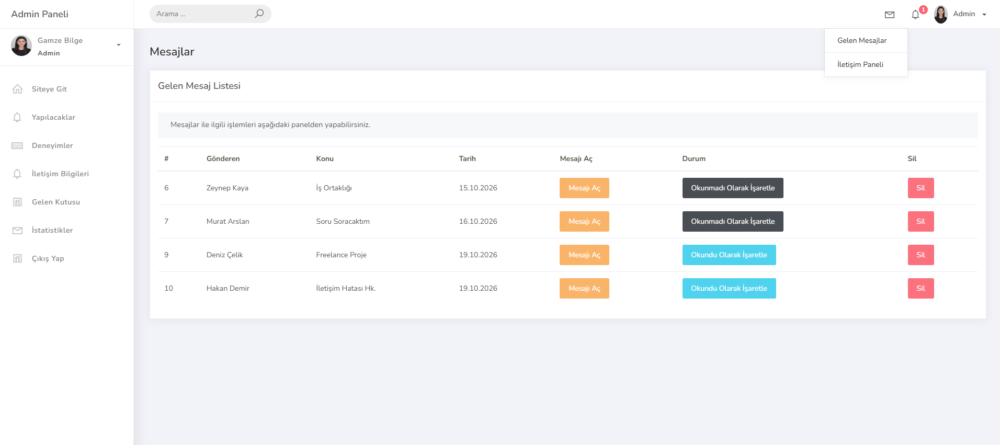
</p>

### 📊 İstatistikler
<p align="center">
  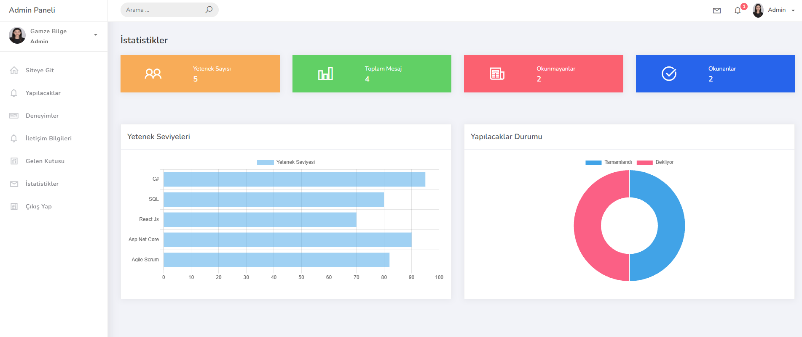
</p>

## 🚀 Kurulum

1. Projeyi bilgisayarınıza indirin:

   ```bash
   git clone https://github.com/GamzeBilge1/MyPortfolio.git
   ```

2. `MyPortfolio.sln` dosyasını Visual Studio ile açın.
3. Gerekli NuGet paketlerini yükleyin.
4. `MyPortfolioContext.cs` içerisindeki bağlantı cümlesini kendi SQL Server ortamınıza göre düzenleyin.
5. Gerekli veritabanını ve tabloları oluşturun.
6. Projeyi çalıştırın.

## 👩‍💻 Geliştirici

**Gamze Bilge**
- [LinkedIn Profilim](https://www.linkedin.com/in/gamze-bilge1/)

